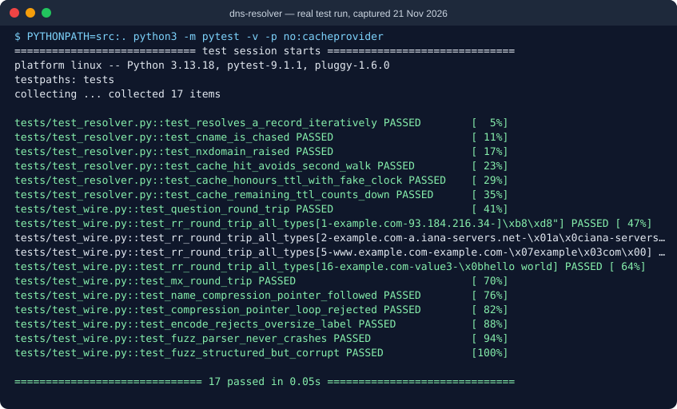

# minidns — a DNS resolver from scratch — manual

*One page, eight blocks. Every figure here comes from this repository's own tests and README.*

## 1. Claim
A standard-library-only recursive resolver whose parser survives 8,000 random and corrupt packets, raising only DNSFormatError and never crashing.

## 2. What it is
A DNS resolver built from the RFC 1035 wire format up. It walks from the root servers to the answer, follows CNAMEs and caches by TTL, without using any DNS library.

## 3. Demo
Live: `python -m minidns.cli example.com A` (needs outbound UDP/53). Capture to record.


*Real output from this repository's own tests, captured 21 Nov 2026.*

## 4. Run it yourself
**Prerequisites:** Python 3.

```bash
pip install -e ".[dev]"
pytest -q
python -m minidns.cli example.com A
```

## 5. What you will see
14 tests pass, with no network needed. The CLI prints a dig-like answer.

## 6. 30-second talking point
> Using a stack and being able to fix it are different skills. I wrote the DNS wire format by hand, kept I/O separate so every path is tested offline, and fuzzed the parser, because the parser is the attack surface.

## 7. Scope and limits
- Educational resolver, not a hardened production server. No DNSSEC validation, EDNS0 or rate-limiting.

## 8. Links
[Repository](https://github.com/fhionnghaile/dns-resolver) · [Write-up](https://padraigfhionnghaile.com/work/dns-resolver/) · [README](README.md)
